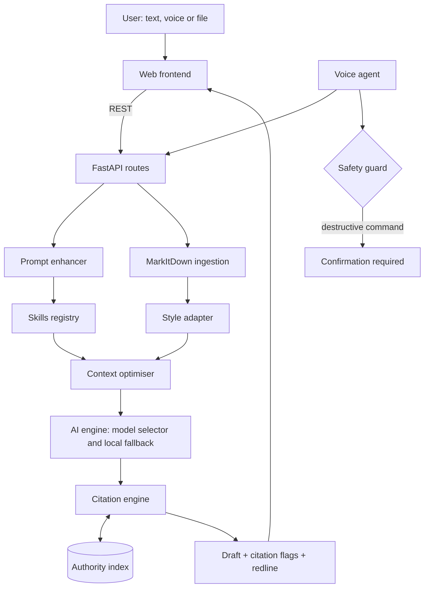

# DraftMate AI: Legal Intelligence Studio

An AI-assisted drafting, review and citation-checking workspace for Indian legal practice. Built as a working prototype for the **Kodekurrent Season 2 Hackathon** at RGIPT (AI / LegalTech track), where it placed **1st Runner-Up**.

> **Status:** hackathon prototype. It is a drafting assistant, not a source of legal advice. Everything it produces must be reviewed by a qualified lawyer.

---

## The problem

General-purpose AI chatbots draft quickly, but they can invent case law and statute references. A lawyer then has to re-check every citation by hand, which removes much of the time saved. DraftMate adds a checking layer around the language model so that citations are never silently trusted.

## What it does

| Capability | What you get |
|---|---|
| **Drafting workflows** | Contract drafting, legal notices, court petitions, contract review with redlining, and case-law research, each invoked with an `@Tag` or a quick-action chip |
| **Reference-style adaptation** | Upload a PDF or DOCX; the draft follows its tone, clause numbering and defined terms |
| **Citation audit** | Each citation in a draft is checked against a curated authority index and marked **Verified**, **Partially Verified** or **Flagged** |
| **Redline view** | Strike-through and highlight comparison between versions of a draft |
| **Prompt strength meter** | Live score for how complete an instruction is, with an "Improve Prompt" button that adds jurisdiction, governing statute and liability terms |
| **Voice input** | Dictate instructions or issue commands; destructive commands (overwrite, delete) need explicit confirmation |
| **Counsel companion** | A defense-counsel persona that reviews a draft from the opposing side's point of view and suggests remedial clauses |
| **Export** | Markdown, Word, or print to PDF |

## How it works



1. The user picks a workflow, writes or dictates an instruction, and optionally attaches a reference document.
2. Attached files are converted to Markdown with Microsoft MarkItDown, and style cues are extracted.
3. The prompt is scored and enriched, and the context is trimmed before the model call.
4. The selected model produces a draft.
5. The citation engine extracts references from the draft and checks them against the authority index.
6. The user reviews the draft, citation flags and redline, then exports.

### About the citation check

"Verified" means a citation was **found in the project's curated authority index**. It does not mean the citation is correct in every respect, and it does not check whether a law has since been amended or overruled. Anything not found is shown as **Partially Verified** or **Flagged** so a human reviews it. The index currently covers a limited set of major Indian statutes and landmark precedents.

## Tech stack

| Layer | Technology |
|---|---|
| Backend | Python, FastAPI |
| Document ingestion | Microsoft MarkItDown |
| Context optimisation | Headroom |
| Frontend | HTML, Tailwind CSS, JavaScript (React/Next.js component set included under `frontend/src`) |
| Models | Selectable LLM providers via API, plus a local fallback mode |
| Voice | Speech dictation and command interpreter with a confirmation guard |

## Quickstart

**Requirements:** Python 3.10 or newer and a modern web browser.

```bash
git clone https://github.com/divyanshkdvs/draftmate_ai.git
cd draftmate_ai
pip install -r requirements.txt
```

Add the API key(s) for the model provider(s) you want to use in a `.env` file in the project root. Without a key, the app runs in its local fallback mode.

Run the validation tests, then start the studio:

```bash
python test_suite.py
python run.py
```

Open <http://127.0.0.1:8000> for the studio, or <http://127.0.0.1:8000/docs> for the interactive API docs.

## Project structure

```
draftmate_ai/
├── run.py                  # Launcher
├── test_suite.py           # Validation tests for the core modules
├── requirements.txt
├── backend/
│   ├── main.py             # App setup, CORS, static files, routes
│   ├── core/
│   │   ├── markitdown_engine.py   # Document to Markdown ingestion
│   │   ├── headroom.py            # Context optimisation
│   │   ├── style_adapter.py       # Reference-based style adaptation
│   │   ├── prompt_enhancer.py     # Prompt scoring and enrichment
│   │   └── ai_engine.py           # Model selection and fallback
│   ├── skills/registry.py         # Legal workflow definitions
│   ├── verification/
│   │   ├── citation_engine.py     # Citation extraction and checking
│   │   └── authority_db.py        # Curated statutes and precedents
│   ├── voice/
│   │   ├── voice_agent.py         # Command interpreter
│   │   └── safety_guard.py        # Confirmation for destructive actions
│   ├── documents/                 # Sample matters and uploads
│   └── api/                       # Route modules
└── frontend/
    ├── index.html
    ├── static/app.js
    └── src/components/            # React component set
```

## Scope and known limitations

- **Prototype scope.** Built in a hackathon timeframe. It has no user accounts, audit logging or production-grade security.
- **Limited authority index.** The citation check is only as complete as the curated index. Larger sources such as India Code or court databases are not yet connected.
- **No currency check.** It does not detect amended, repealed or overruled law.
- **Model-dependent output.** Draft quality depends on the selected model, and models can still make mistakes. The citation flags are a safety net, not a guarantee.
- **Confidentiality.** Documents sent to a cloud model leave the local machine. Use the local mode, or add redaction and an enterprise API agreement, before handling real client material.
- **Demo data.** The sample matters and company names shown in the interface are placeholders.
- **Voice accuracy.** Speech recognition can misinterpret commands, which is why destructive actions require confirmation.

## Roadmap

- Connect larger legal sources (India Code, court judgment databases) and track amendments
- Add authentication, audit trails and document redaction
- Measure and publish citation-check accuracy on a test set
- Add a benchmark for the context-optimisation step

## How it was built

This version was led by Divyansh Kumar, who handled product design, feature selection and research into existing legal-tech tools. The code was developed with an AI coding assistant Claude Opus 4.6, Claude Sonnet 4.6, Gemini Anti-gravity, GPT-OSS 120B under his direction, and he reviewed and tested the result with his team members. The interface takes design inspiration from modern legal-tech products.

## Acknowledgements

- [Microsoft MarkItDown](https://github.com/microsoft/markitdown): document-to-Markdown conversion
- [Headroom](https://github.com/headroomlabs-ai/headroom): context and token optimisation
- [Claude for Legal](https://github.com/anthropics/claude-for-legal) and [Awesome Legal Skills](https://github.com/lawve-ai/awesome-legal-skills): references for structuring legal workflows
- [OpenWhispr](https://github.com/OpenWhispr/openwhispr): reference for voice interaction

## Team

DraftMate was created by a team of four at RGIPT for the Kodekurrent Season 2 Hackathon. Team built 3 prototype, and this version was selected as the team's final submission.

| Name | Program | GitHub |
|---|---|---|
| Divyansh Kumar | B.Tech, Mathematics and Computing, RGIPT | [@divyanshkdvs](https://github.com/divyanshkdvs) |
| Yuvraj Singh Rathore | B.Tech, Information Technology, RGIPT | [@Yuvrajsinghrathor](https://github.com/Yuvrajsinghrathor) |
| Shubrat Singh | B.Tech, Information Technology, RGIPT | [@faqlodeongames-glitch](https://github.com/faqlodeongames-glitch) |
| Shrey Kushwaha | B.Tech, Information Technology, RGIPT | [@Shrey-K017](https://github.com/Shrey-K017) |

## Disclaimer

DraftMate is a research and drafting aid. It does not provide legal advice, and its output should not be relied on without review by a qualified legal professional.
